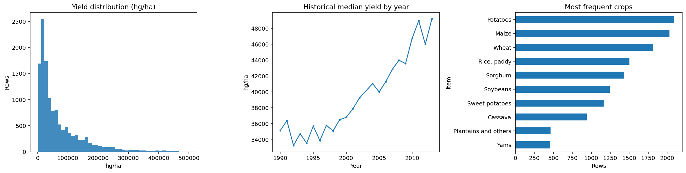
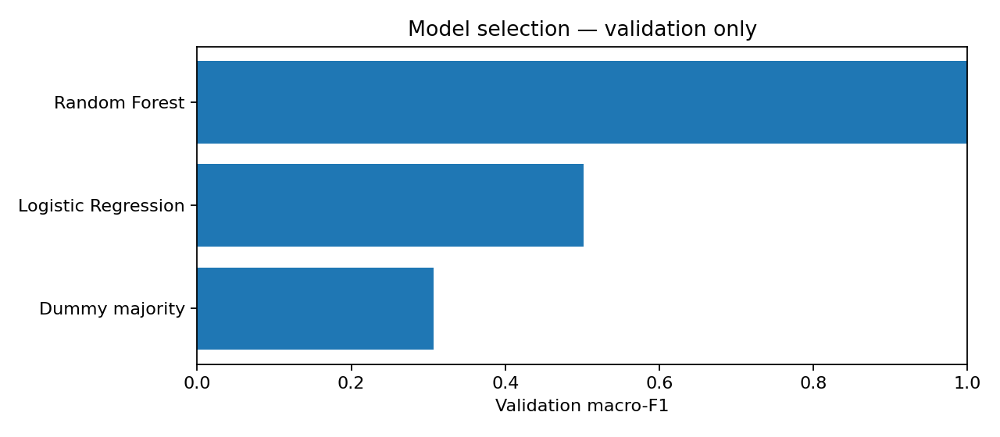
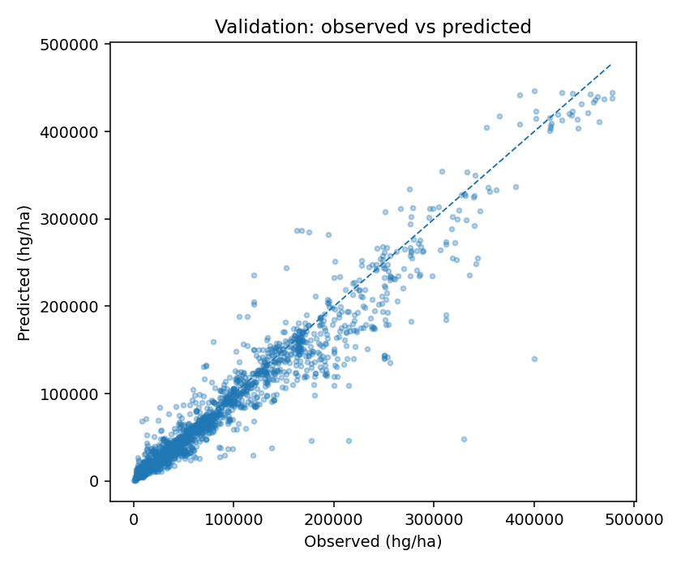
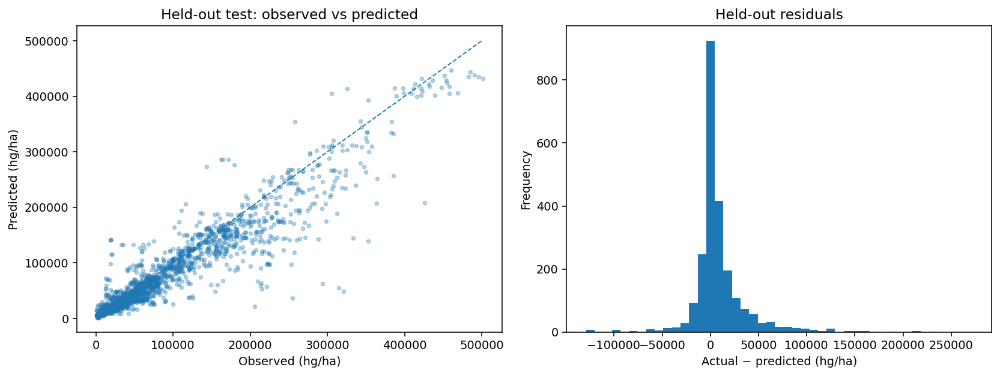
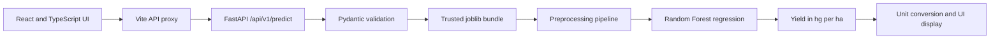

# HarvestForecast 🌾

**Day 37 / 100 Days of Projects** · Historical agricultural yield regression · **Research prototype**

[English documentation](docs/en/README.md) · [Dokumentasi Bahasa Indonesia](docs/id/README.md) · [Notebook](notebooks/harvestforecast.ipynb) · [Model card](docs/en/model_card.md) · [GitHub](https://github.com/MENSTRUE/HarvestForecast)

## Executive summary / Ringkasan

HarvestForecast estimates **historical country/area × crop × year yield per hectare**, using recorded rainfall, pesticide and average temperature covariates. It connects a reproducible Kaggle experiment to a local React dashboard and FastAPI regression endpoint. **This is retrospective benchmarking, not a proven pre-season crop yield forecast or farm advisory service.**

HarvestForecast mengestimasi **hasil panen historis per hektare** pada kombinasi wilayah × tanaman × tahun dengan variabel hujan, pestisida, dan suhu tahunan. Proyek menghubungkan eksperimen Kaggle dengan dashboard React dan API FastAPI lokal. **Ini benchmark retrospektif, bukan ramalan panen sebelum musim tanam atau layanan advisori lahan yang tervalidasi.**

## Problem, users, research questions

Agricultural decision support requires transparent estimates, but common ML demos confuse aggregate historic yield modeling with operational forecasting. The relevant users are researchers, data scientists, agricultural analysts and engineering reviewers, **not autonomous field controllers**. The research questions: Can a model generalize from older to later historical years, beat simple baselines, and expose honest limitations through an API/UI? Non-goals: plot-level advice, total harvest tonnage without land area, new-region generalization claims, and automated pesticide/irrigation recommendations.

## Current status and evidence

| Component | Audited state |
|---|---|
| Dataset / notebook | Five input files inventoried; one merged table trained; notebook committed |
| Cleaning | 25,932 rows → **13,130** retained; duplicated area/crop/year keys reviewed |
| Champion | `random_forest_120`, selected using validation MAE only |
| Model | Saved `joblib` bundle with nested sklearn pipeline and six features |
| Backend | FastAPI endpoints for health, model info and regression inference |
| Frontend | React 18 + Vite 6 responsive dashboard and manual estimation form |
| Local UI | Model-online screenshot exists; prediction form result not independently verified |
| Deployment | No verified public deployment, production operations or farm pilot |
| License | Source redistribution permissions and project license **not finalized** |

## Dataset, target and features

Primary training CSV: `df_yield_merged.csv` from the Kaggle mount `/kaggle/input/datasets/wafabila/harvestforecast-dataset`. The additional source files `yield.csv`, `rainfall.csv`, `temp.csv`, and `pesticides.csv` were audited separately, **not added as extra training rows or rejoined**. Original upstream reference and license are **unverified**; see [provenance](docs/en/dataset_provenance.md). Raw input data are not tracked.

The target is **`value_hg_ha` (hg/ha)**. Input columns, in saved order:

| Field | Role / measurement |
|---|---|
| `area` | Geographic area/country category |
| `item` | Crop category |
| `year` | Calendar year |
| `average_rain_fall_mm_per_year` | Annual precipitation, mm/year |
| `pesticides_tonnes` | Annual pesticide-use aggregate, tonnes |
| `avg_temp` | Average annual temperature, °C |

Annual covariates may only become available after harvest, which restricts use to retrospective estimations unless independently forecast/available at the real decision point. Units in API output: **hg/ha**, **kg/ha** = hg/ha ÷ 10, **tonnes/ha** = hg/ha ÷ 10,000.

## Dataset audit and leakage controls

The source contained 25,932 rows, zero recorded invalid/quarantined rows, zero exact duplicate rows, and 12,802 repeated area–crop–year rows removed following conflict checks. The retained table has **13,130** records across 101 areas and 10 crops, covering 23 distinct years between 1990 and 2013. Reported feature missingness is zero after cleaning. The target is never a predictor. Preprocessing is fitted on train only; datasets are not randomly mixed across years. However, **area/crop identities recur** across periods (581 train–validation pairs, 580 train–test pairs), so geography OOD has not been demonstrated.

## Evaluation design and results

| Split | Complete calendar years | Records |
|---|---|---:|
| Training | 1990–2005 | 8,444 |
| Validation | 2006–2009 | 2,331 |
| Held-out test | 2010–2013 | 2,355 |

Seven candidate/baseline methods were compared. `random_forest_120` won by **validation MAE 11,232.15 hg/ha** (lower is better). The test set was not used for champion selection according to the saved experiment records.

| Held-out test metric | Recorded value |
|---|---:|
| MAE | **16,393.51 hg/ha** |
| RMSE | 30,993.08 hg/ha |
| R² | 0.8743 |
| WAPE | 20.16% |
| Test rows | 2,355 |

Error varies by crop and year; MAE is 33,793.67 hg/ha for Sweet potatoes (206 examples) versus 3,353.48 hg/ha for Soybeans (227 examples); year-level MAE rises between 2010 and 2013. This is a **regression** problem: class-wise precision/recall and confusion matrices are not applicable. See the original [validation leaderboard](reports/extracted/validation_leaderboard.csv), [test metrics](reports/extracted/heldout_test_metrics.json), [crop error](reports/extracted/heldout_test_mae_by_crop.csv), and [year error](reports/extracted/heldout_test_mae_by_year.csv).

## Experiment and application visuals



*Figure 1 — Descriptive distribution, historical medians and represented crops; not an evaluation metric.*



*Figure 2 — Validation comparison. Only validation data determine champion selection.*



*Figure 3 — Recorded validation relationship, not held-out test or calibrated uncertainty.*



*Figure 4 — Held-out diagnostics; examine large residuals and group-level error before interpreting aggregate metrics.*


*Figure 5 — Actual local dashboard screenshot showing model availability; does not prove an end-to-end prediction or public deployment.*

## Technical architecture and inference workflow



The artifact is a **dictionary**, not a bare regressor: `artifact['kind']='sklearn_pipeline'`, `artifact['model']` holds the trained Pipeline; `features`, `target`, `unit` define its contract. The backend explicitly verifies this structure. The frontend uses client-side views for Overview, Yield prediction and Model insights. No authenticated accounts, database, live farm sensor collection, or external inference hosting exists in the checked code.

## Local installation (Windows PowerShell)

Prerequisites: Windows PowerShell, compatible Python with requirements in [`backend/requirements.txt`](backend/requirements.txt), Node.js/npm, the saved trusted model file, and normal localhost ports 8000/5173. The historical training environment uses Kaggle CPU and seed 42; see [reproducibility](docs/en/reproducibility.md).

**Terminal 1 — API**

```powershell
cd "D:\porto\100 day\day 37"
& "C:\DevEnvs\ai-general\Scripts\python.exe" -m pip install -r backend\requirements.txt
& "C:\DevEnvs\ai-general\Scripts\python.exe" -m uvicorn backend.app.main:app --reload --port 8000
```

Visit `http://127.0.0.1:8000/docs` or `/api/v1/health`.

**Terminal 2 — UI**

```powershell
cd "D:\porto\100 day\day 37\frontend"
npm install
npm run build
npm run dev
```

Visit `http://127.0.0.1:5173`.

The API `POST /api/v1/predict` accepts a flat JSON body with the six fields above and returns `prediction_hg_ha`, `prediction_kg_ha`, and `prediction_tonnes_ha`. Provide category spellings from training data; **do not claim a random illustrative form value as a validated agronomic estimate**. Inspect [backend specification](backend/README.md) for validation bounds and errors.

## Reproducibility, integrity and verification

- Primary experiment: [`notebooks/harvestforecast.ipynb`](notebooks/harvestforecast.ipynb), seed `42`.
- Source hashes and licensing uncertainty: [`dataset_provenance.json`](reports/extracted/dataset_provenance.json).
- Chronological membership and recurring categories: [`split_audit.json`](reports/extracted/split_audit.json).
- Saved winner and performance: [`model_selection.json`](reports/extracted/model_selection.json), [`heldout_test_metrics.json`](reports/extracted/heldout_test_metrics.json).
- Saved model SHA-256: `2ac6e5aca35241065cfb93f78f70181fad740aa8dfc6e7c1f237233b528611f0` (per manifest).
- `joblib`/pickle must **never** load arbitrary untrusted files. Current `scripts/inspect_model.py` introspects the outer bundle rather than its nested model; see [scripts](scripts/README.md).

No repeat-run equivalence, automated test coverage, public hosting or independent prospective crop trial has been verified. The experiment reports are reproducibility resources, not third-party validation certificates.

## Before → Now → Next

**Before:** assemble source inventory, find legitimate yield-per-area target, audit duplicates and chronological leakage, establish a dummy/historical baseline. **Now:** validation-selected Random Forest, held-out results, saved preprocessing and local React/FastAPI research UI. **Next (priority):** (P0) actual API positive/negative prediction tests and category controls; (P1) licensing/origin validation and held-out location tests; (P2) prospective feature availability, uncertainty, monitoring and public deployment security assessment. Each stage requires measurable evidence, not status labels alone.

## Known limitations, security and FAQ

**Q: Does it forecast next season?** No. Annual rainfall, temperature and pesticides may be known only after the target year. **Q: Is 0.8743 R² field accuracy?** No. It is held-out fit on the reported later-year aggregate dataset. **Q: Does hg/ha equal total harvested mass?** No. Multiply yield-per-hectare by separately verified hectares for production. **Q: Are new countries supported?** The encoder ignores unseen category values; a numeric output would not validate that case. **Q: Is it production-ready?** No verified deployment, security review or farm trial.

`LICENSE` currently says **no license selected**; consequently project and third-party redistribution rights are **not settled**. Do not imply open-source licensing solely from a public GitHub repository. Review [limitations](docs/en/limitations.md), [security and deployment](docs/en/deployment.md), [English docs](docs/en/README.md) and [Indonesian docs](docs/id/README.md).

## Author and references

Maintained in [MENSTRUE/HarvestForecast](https://github.com/MENSTRUE/HarvestForecast). Primary evidence is the committed notebook and `reports/extracted` artifacts; the claimed upstream Zenodo record is **not yet verified** against exact source hashes or licensing. Both language guides describe the actual implementation and its boundaries.
